<h1 align="center">screenplay</h1>

<p align="center">
  <b>Turn a raw talking-head recording into a motion-graphics edit.</b><br>
  An AI agent writes one YAML file. The engine handles the cutting, timing, animation and rendering.
</p>

<p align="center">
  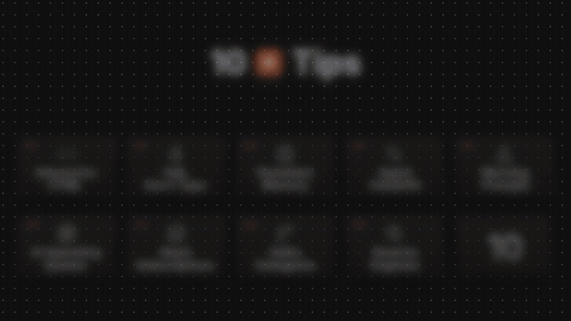
</p>

<p align="center">
  <sub>Real output, shown without sound. 2:56 of raw camera footage became a 1:39 edit. The final render takes about a minute.</sub>
</p>

## What it makes

Every frame on this page is a real render from the engine.

<table>
  <tr>
    <td width="50%">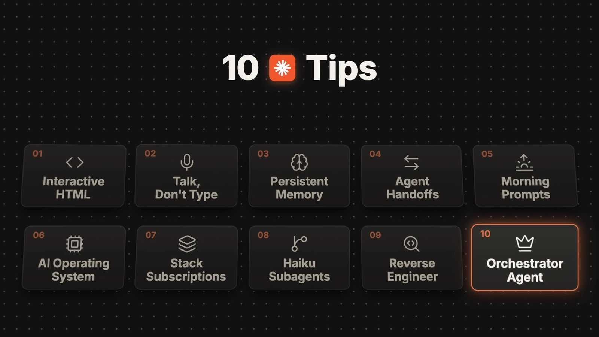<br><b>Chapter cards.</b> A grid of every part, with the current one lit. It takes the full screen for 2 seconds at each chapter switch.</td>
    <td width="50%">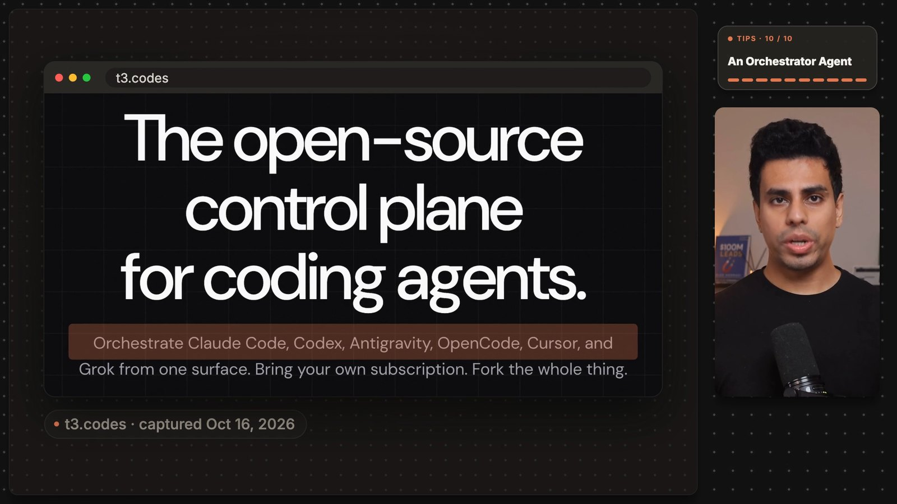<br><b>Real proof.</b> Claims get the actual page, with a marker that lands on the phrase as it's spoken and a source pill underneath.</td>
  </tr>
  <tr>
    <td>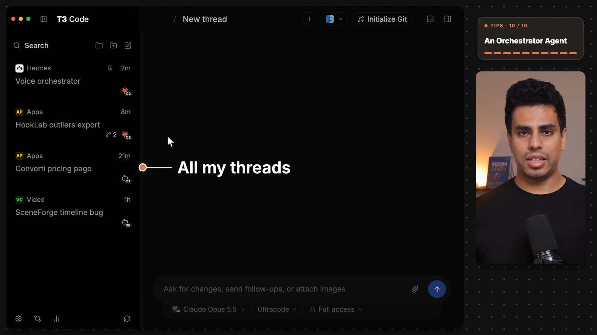<br><b>Puppeted apps.</b> Apps rebuilt in code, driven by a scripted cursor, with callouts timed to the voice.</td>
    <td>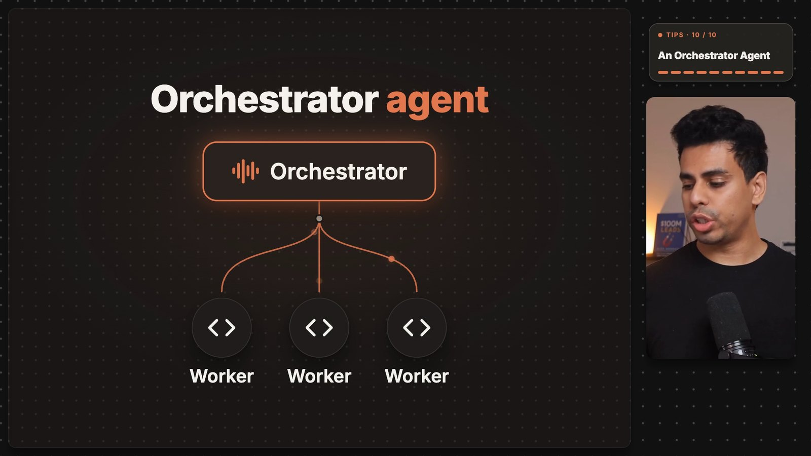<br><b>Diagrams.</b> For ideas with nothing to screenshot. Each node appears on the word that names it.</td>
  </tr>
  <tr>
    <td>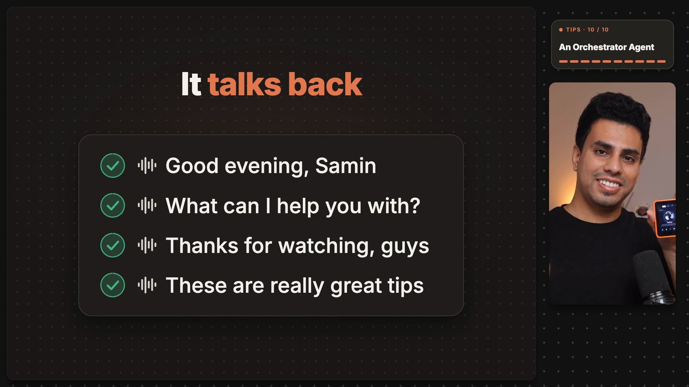<br><b>Lists that build.</b> The card grows as each row lands, so it's never an empty shell.</td>
    <td>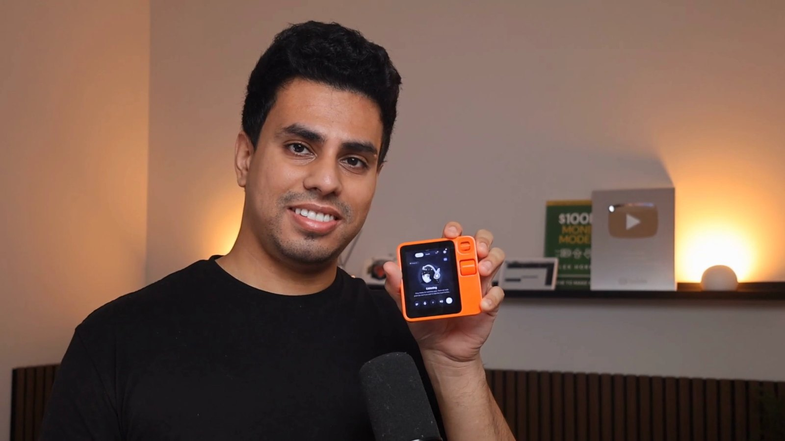<br><b>Full-screen moments.</b> The closing shot grows out of the tile with a blur-morph.</td>
  </tr>
</table>

## The trick

The "screen recordings" aren't recordings.

Think of a puppet show. The app on screen is a puppet: a pixel-clean copy of the real thing, built in React, filled with made-up data. A scripted cursor moves it, so it looks like the computer is being controlled.

That one idea gives you three things:

- **Timing.** Every click lands on the exact word you say, because nothing is being performed live.
- **Privacy.** There are no real emails, paths or customer names to blur, because none of them were ever on screen.
- **Sharpness.** Text stays crisp at any zoom, because it's drawn rather than filmed.

For anything you claim out loud, the rule flips: show the real page, with the real address and capture date.

## How it works

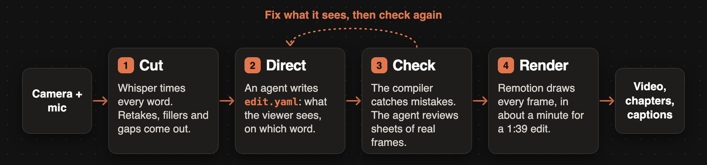

1. **Cut.** Whisper gets a timing for every word. The engine finds retakes, fillers and false starts, removes them, trims the gaps and levels the audio to −16 LUFS. On a Mac it also follows your face so the tile stays on your head.
2. **Direct.** An agent reads the transcript and writes `edit.yaml`: what the viewer sees, and on which word. It makes editorial choices only and never writes animation code or frame numbers.
3. **Check.** The compiler catches mistakes with exact YAML paths: a phrase that wasn't spoken, a target that doesn't exist, a headline that's too long, a stretch where nothing changes on screen. The agent then reviews contact sheets of real frames, fixes what it sees, and repeats.
4. **Render.** Remotion renders the video, and you also get a chapter list for the YouTube description and an `.srt` caption file.

## One file drives it all

This is the whole scene behind the annotated frame further down. Beats hang off **spoken phrases, not timestamps**, so if you recut the video they move with the words.

```yaml
- kind: stage
  at: "So for example"
  elements:
    - type: image
      src: media/14-samrabbit-repo-crop.png
      url: github.com/Samin12/SamRabbit
      crop: [2540, 350, 640, 375]
      source: "github.com/Samin12/SamRabbit · captured Oct 16, 2026"
      highlight:
        - { x: 2787, y: 432, w: 240, h: 44, at: "this voice guy" }
        - { x: 2570, y: 480, w: 425, h: 44, at: "this voice guy" }
```

An app scene reads like stage directions for the cursor:

```yaml
- kind: app
  at: "This thing knows about"
  app: t3-code
  data: { ... }   # fictional projects and threads
  beats:
    - { at: "all my coding threads", callout: sidebar, text: "All my threads", side: right, until: "helps me" }
    - { at: "helps me manage", click: thread-orchestrator, set: { active: orchestrator } }
    - { at: "alerts me", mark: hl-converti, style: marker, until: "my attention" }
```

See the full 1:39 edit in [`examples/demo-tips/edit.yaml`](examples/demo-tips/edit.yaml) and the complete format in [`docs/EDIT-YAML.md`](docs/EDIT-YAML.md).

## The layout

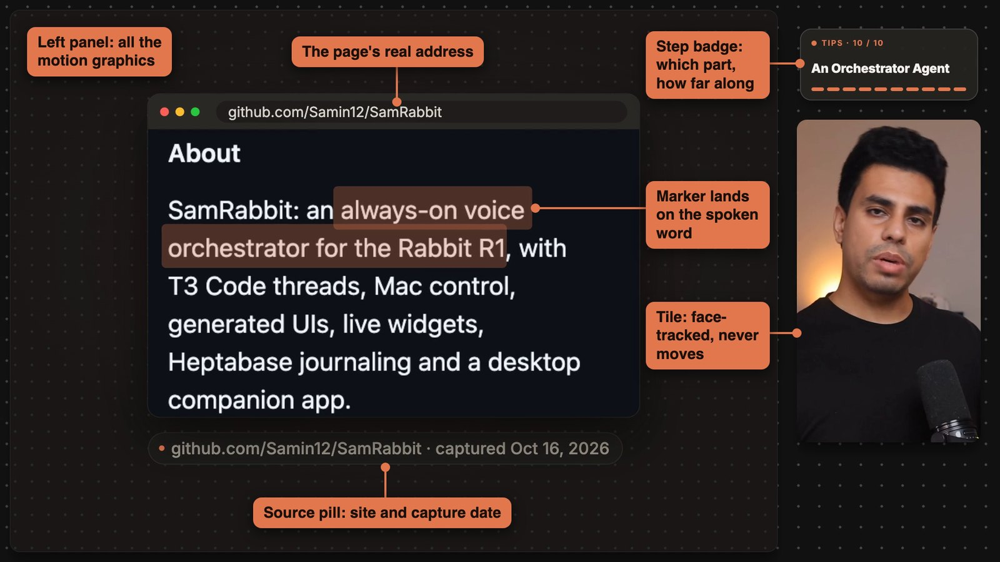

The default, `look: panel`, keeps one layout across every video: you in a tile on the right, a step badge above you, and everything else in the left panel on a dark dot-grid canvas. Viewers always know where to look.

Two things break the layout on purpose: the chapter card at a chapter switch and a closing shot. Set `look: reference` for full-frame layouts with a big webcam instead.

## App replicas

These four ship with the engine. All the data in them is fictional.

<table>
  <tr>
    <td width="50%">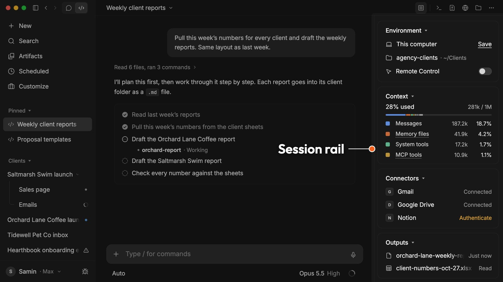<br><code>claude-desktop</code></td>
    <td width="50%">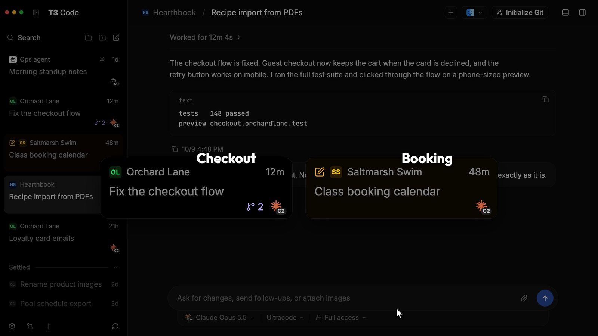<br><code>t3-code</code></td>
  </tr>
  <tr>
    <td>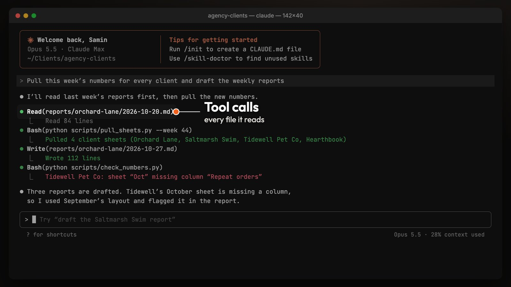<br><code>terminal</code></td>
    <td>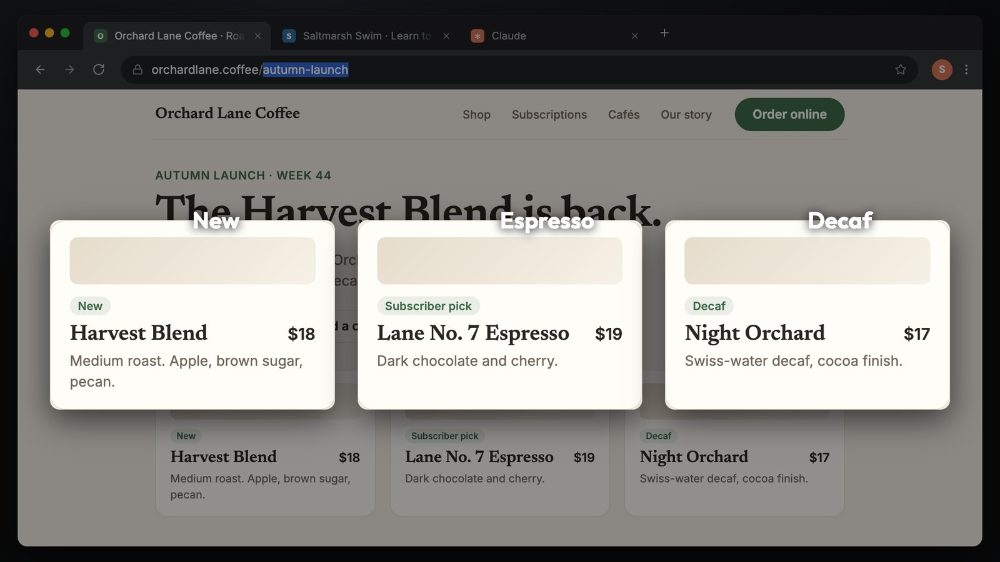<br><code>browser</code></td>
  </tr>
</table>

The agent directs them with a small set of verbs: `click`, `type`, `callout`, `lift`, `explode`, `focus`, `mark`, `zoom`. Run `screenplay replicas` to list every app, its targets and its state keys.

If a video is about another product, build that product its own replica from screenshots instead of relabelling one of these. [`docs/REPLICAS.md`](docs/REPLICAS.md) walks through it.

## Stage elements

The building blocks for everything that isn't an app or a web page.

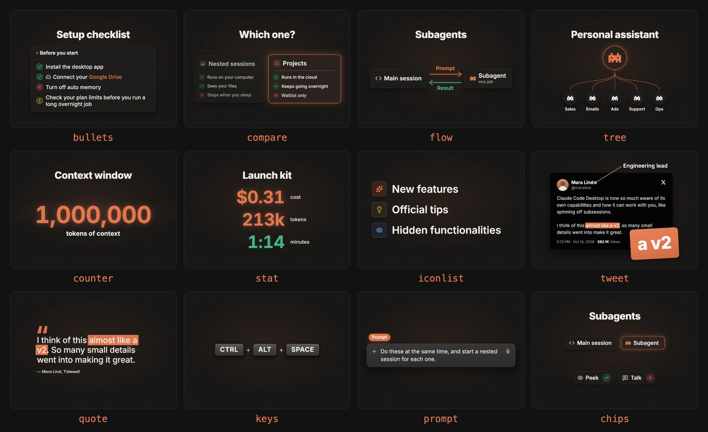

Also available: `title`, `image`, `table`, `grid`, `lower` and `cta`.

## Install

You'll need macOS (tested on Apple Silicon), Node 22.18 or newer, ffmpeg, and [whisper.cpp](https://github.com/ggml-org/whisper.cpp)'s `whisper-cli` with a model in `~/.cache/whisper/` (`ggml-large-v3-turbo.bin` preferred, `ggml-small.bin` works).

```bash
git clone https://github.com/Samin12/screenplay.git
cd screenplay
npm install
npm link        # puts `screenplay` on your PATH
```

Face tracking uses Apple's Vision framework through `swift` (Xcode command line tools). Without it, the tile holds a fixed crop.

## Try it without a recording

The test timelines in `examples/tests/` render on their own, with no footage needed:

```bash
npx remotion still src/index.ts Main out.png --props=examples/tests/replica-t3-code.json --frame=174
npm run studio   # scrub the sample timeline in Remotion Studio
```

## Edit a recording

```bash
screenplay init work --camera cam.mov --mic mic.wav
screenplay transcribe work && screenplay cut work && screenplay aroll work
screenplay brief work                  # the transcript your beats anchor to
$EDITOR work/edit.yaml                 # or let the agent write it
screenplay check work                  # must report 0 errors
screenplay sheet work --every 2s       # contact sheets to review
screenplay render work -o work/out/final.mp4
```

## Use it with Claude Code

The repo ships a skill with the full workflow, the style rules and a log of learned preferences. Link it:

```bash
ln -s "$PWD/plugins/screenplay/skills/screenplay-edit" ~/.claude/skills/screenplay-edit
```

Or install it as a plugin:

```text
/plugin marketplace add Samin12/screenplay
/plugin install screenplay@screenplay
```

Then ask: *"screenplay-edit my recording cam.mov with mic mic.wav"*. The agent runs the loop above and reports back with what it changed and which audio joins you should listen to.

## What's in the repo

| Folder | What it holds |
|---|---|
| `cli/` | The `screenplay` CLI: media pipeline, word-anchor resolver, compiler, linter, stills, contact sheets, renders |
| `src/app/` | The replica system: target measurement, scripted cursor, camera, callouts, lifted clones, focus, marks |
| `src/replicas/` | The four app replicas |
| `src/stage/elements/` | The stage elements |
| `src/scenes/` | Scene kinds: `app`, `stage`, `talking`, `chapter`, `board`, `plug` |
| `src/layers/` | Panel and canvas, step badge, webcam tile, transitions |
| `plugins/screenplay/` | The Claude Code plugin and `screenplay-edit` skill |
| `docs/` | [EDIT-YAML.md](docs/EDIT-YAML.md) (the format) and [REPLICAS.md](docs/REPLICAS.md) (build a replica) |
| `examples/` | `demo-tips/edit.yaml`, a worked example, and `tests/`, standalone timelines |

## Good to know

- **The demo can be read, not re-rendered.** The footage, transcripts and captures behind `examples/demo-tips` aren't in this repo.
- **The agent can't hear.** It checks frames and audio levels, so you should still listen to the cuts yourself.
- **Replicas are illustrations.** They depict real product features with made-up data. Say so if it matters for your video.
- **No music or sound effects** are added by default.
- **Remotion has its own license.** It's free for individuals and companies of up to 3 people. Larger teams need a [company license](https://remotion.dev/license).

## Credits

The motion language is inspired by RoboNuggets' ["Anthropic Just Shipped Claude 2.0"](https://youtu.be/yMnFHFf43Qg), the video that showed puppeted replicas could look this good.

Built on [Remotion](https://remotion.dev), [whisper.cpp](https://github.com/ggml-org/whisper.cpp) and [ffmpeg](https://ffmpeg.org). Not affiliated with Anthropic, T3 Code or RoboNuggets. Product names belong to their owners.

## License

[MIT](LICENSE)
